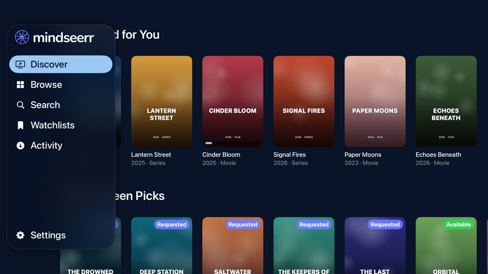
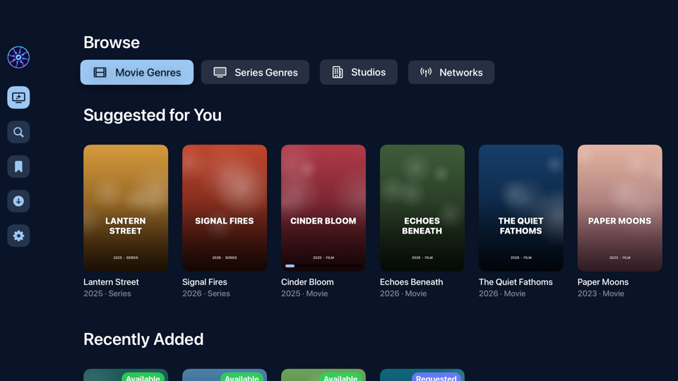
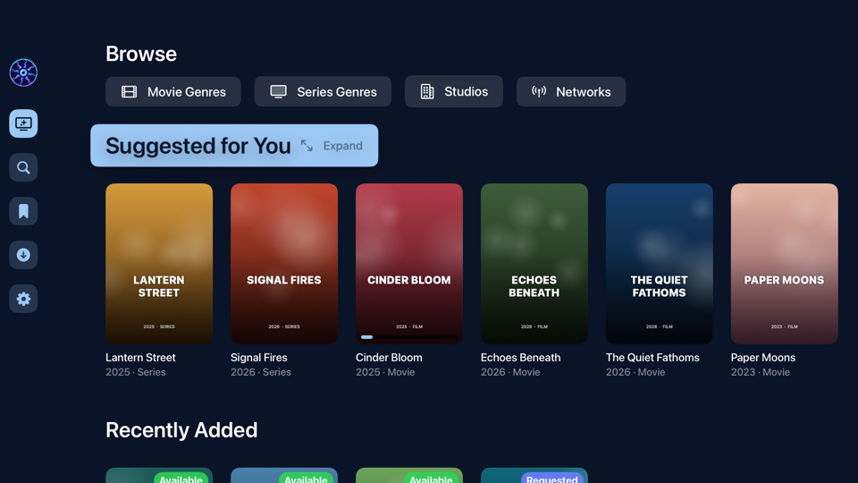
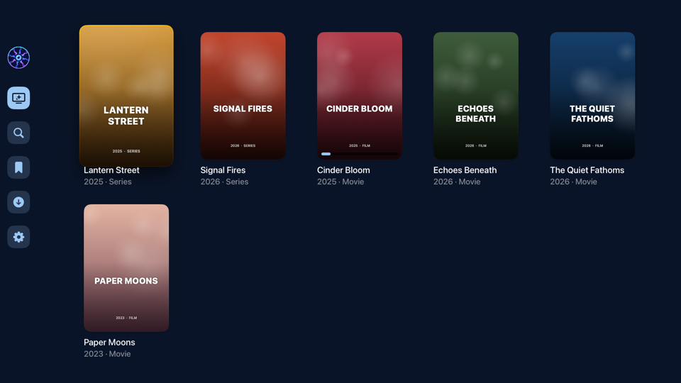
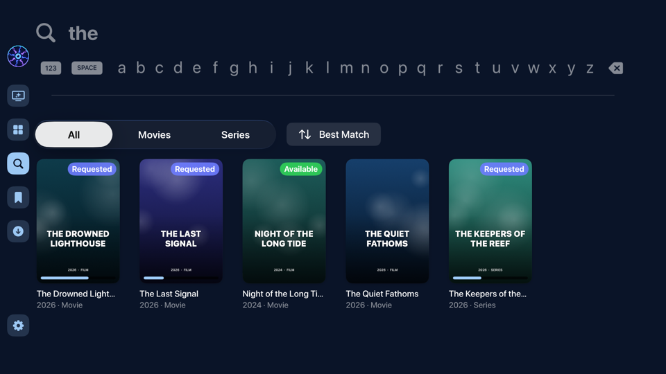
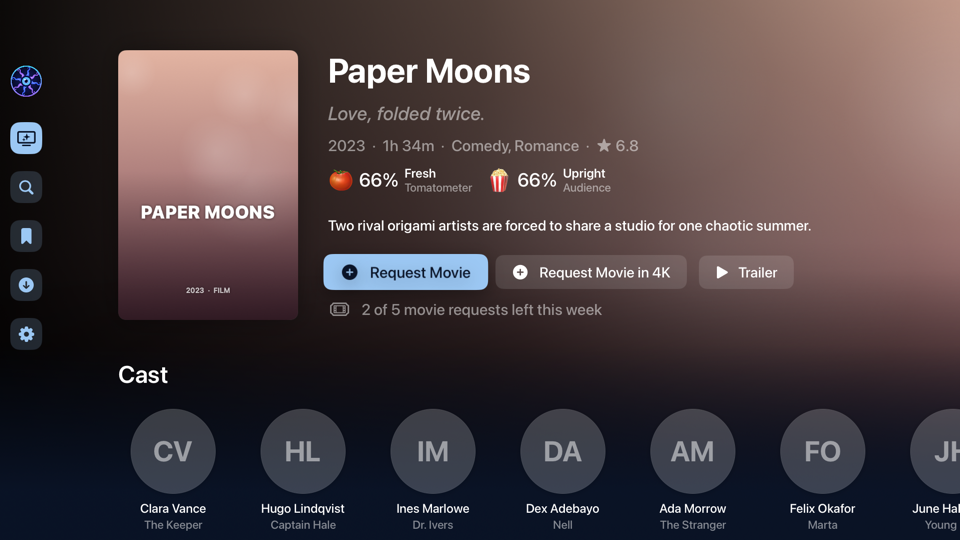
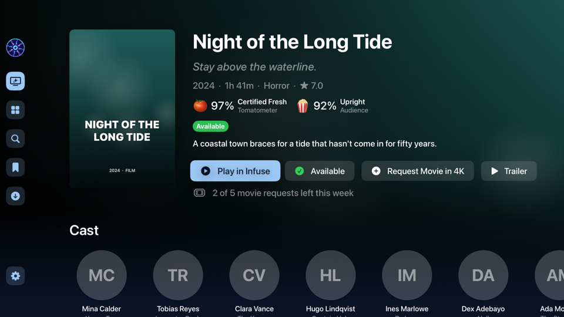
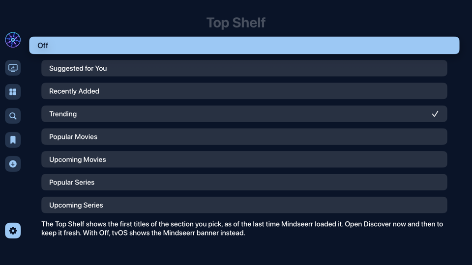
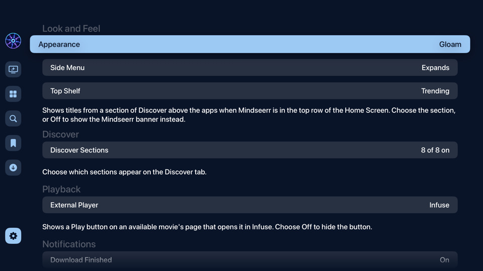

<p align="center">
  <br>
  
</p>

<p align="center">
  A native Apple TV client for <a href="https://docs.seerr.dev">Seerr</a> (the merged Overseerr + Jellyseerr project).<br>
  Discover, request and watch what's coming, from the couch, with the remote.
</p>

<p align="center">
  
</p>

- **Discover** trending, popular and upcoming titles, browse by genre, studio or network, and get **Suggested for You**.
- **Request** movies and series (in HD or 4K), pick seasons, and see what's already on your server.
- **Watch progress** for everything downloading, even for people who don't run Sonarr or Radarr themselves.
- **Manage** your server from the couch: approve requests, connect Sonarr, Radarr, qBittorrent, Deluge, Transmission and SABnzbd, pause or cancel downloads.
- **Watchlists** from Trakt, Letterboxd, TMDB and TheTVDB, with one-step requesting of what's missing.
- **Play** an available title in Apple's player straight from Plex, Jellyfin or Emby, or hand it to Infuse.
- **Top Shelf**, eight themes and four extra languages: Spanish, French, Russian and Simplified Chinese.

*All screenshots are simulated: the titles, poster art, people and downloads are invented and served by the demo server in `Tools/demo-server`. Shown in the Gloam theme.*

## Contents

- [Getting started](#getting-started)
- [Tour](#tour)
- [Download services](#download-services)
- [Watchlists](#watchlists)
- [Settings](#settings)
- [Build, install and IPA](#build-install-and-ipa)
- [How it talks to Seerr](#how-it-talks-to-seerr)
- [Notes and troubleshooting](#notes-and-troubleshooting)
- [Roadmap](#roadmap)

## Getting started

**You need:** a Mac with Xcode 16 or later, [XcodeGen](https://github.com/yonaskolb/XcodeGen) (`brew install xcodegen`), an Apple TV (HD or 4K, tvOS 17+) or the Apple TV simulator, and a Seerr server using Plex, Jellyfin or Emby.

```sh
cd Mindseerr
xcodegen generate
open Mindseerr.xcodeproj
```

1. Select the **Mindseerr** target → *Signing & Capabilities* → pick your Team. Change the bundle ID from `com.example.mindseerr` if you like (or edit `project.yml` and regenerate).
2. Choose an Apple TV simulator or your paired Apple TV and press **Run**.
3. Enter your server's address (like `192.168.1.10:5055` or `seerr.example.com`) and sign in.

To run on a real Apple TV: on the Apple TV open *Settings → Remotes and Devices → Remote App and Devices*, then in Xcode open *Window → Devices and Simulators* and pair it.

### Connecting and signing in

- **Type the address as you like.** Without `http://` or `https://`, Mindseerr tries HTTPS first and falls back to HTTP, and says what actually went wrong if neither answers (not a Seerr server, a redirect to somewhere else, no network). Redirects are only followed within the same server.
- **Plex** uses the TV-friendly code flow: the app shows a 4-character code and you enter it at plex.tv/link on any device. If your Plex sign-in would go to a host other than Plex, Mindseerr asks you to confirm it first.
- **Jellyfin and Emby** use your media server username and password. The app asks Seerr which server it uses and shows the right screen.
- **Seerr account** (email and password, for accounts created in Seerr) and **API key** (signs in as the server's main admin account) are under "Or sign in with".
- **Self-signed HTTPS** is supported after you approve the certificate (see [Notes](#notes-and-troubleshooting)).

The session survives relaunches (cookie and credentials live in the Keychain); if the Seerr session expires, the app signs in again quietly.

## Tour

### Side menu

The menu runs down the left edge: **Discover, Browse, Search, Watchlists and Activity**, with **Settings** at the bottom, each with its own logo. By default it opens into a blurred, see-through panel with the section names while you're on it, and shrinks to just the logos when you move into a page. Press **Select** or **right** on an item to go into that section's first item; selecting the section you're already in sends it back to its top level. **Settings → Look and Feel → Side Menu** can keep it always collapsed instead. Leaving a section and coming back always shows its top level, and Search clears its box.

### Discover



- **Browse** has its own item in the side menu, laid out like Discover: a row each for **Movie Genres, Series Genres, Studios and Networks**. Select a row's title to open it as a full grid, or pick a tile to see its titles. The heading on each results page changes the order (Most Popular, Newest and so on), and studios and networks appear as white logos.
- **Seasonal picks** appear in the run-up to a popular holiday (Christmas, Halloween, Thanksgiving, Easter, Valentine's Day, St. Patrick's Day, Mother's Day, Memorial Day, Pride, Juneteenth, Father's Day, the Fourth of July, Summer, Labor Day and New Year's Eve): a row such as "🎃 Halloween Picks" with movies and series TMDB tags with that holiday, expandable like the others. It's hidden the rest of the year and can be switched off under **Settings → Discover → Discover Sections**.
- **Suggested for You**, **Recently Added**, **Trending**, **Popular Movies**, **Upcoming Movies**, **Popular Series** and **Upcoming Series**. Rows page in more as you scroll, and each title expands into a full-screen grid.
- Every section can be switched off under **Settings → Discover → Discover Sections**.


Posters of titles that are downloading carry a thin progress bar along their bottom edge in your theme's highlight color, on Discover, in expanded sections and in Search.

#### Suggested for You



Mindseerr builds the row from Seerr's own data and balances four things:

| Factor | Weight | What it is |
|---|---|---|
| **Taste** | 50% | Seerr's recommendations for your own recent requests (counted three times as heavily) and for the titles available on your server. A title several of them point at scores higher. |
| **Rotten Tomatoes** | 25% | The Tomatometer, averaged with the audience score when there is one (TMDB's rating stands in when there is none). Well-rated titles are promoted and poorly rated ones demoted. |
| **Trending** | 12.5% | Where the title sits on Seerr's Trending list. Trending titles that nothing recommended still join the candidates. |
| **New** | 12.5% | How recently it came out, or is about to: newest scores highest, fading over about three years. |

Anything already available, being downloaded or requested is dropped, and clearly poorly rated titles are left out as long as enough good ones remain. A pool of 80 good candidates is kept and **40 are shown, reshuffled every 48 hours**; the ten best titles of one shuffle don't come back for 8 days. The row stays hidden until there's something to show. On a non-admin account, "all available titles" may be limited to your own, because Seerr only shows regular users their own requests.



### Search



Search movies and series with the tvOS keyboard. Narrow the results with the **All / Movies / Series** filter, and the sort button cycles **Best Match, Top Rated and Newest**. Results carry availability badges and download progress like Discover.

### Titles and requests



Every title opens to a page with its poster, tagline, year, runtime or season count, genres, rating and overview. Under it are the actions:

- **Request Movie** / **Request Series** sends it to your standard Radarr or Sonarr. When your Seerr server has a 4K server and your account may use it, **Request in 4K** appears beside it. The two copies are tracked separately, so you can have a title in HD and still request it in 4K, and each shows its own status: **Requested**, **Available**, **4K Requested** or **4K Available**. If the server's 4K list can't be read, the 4K button still shows when your account has the permission.
- For a **series** you pick which seasons to request. Seasons already available or requested are locked.
- Users with *Advanced Requests* can override the server, quality profile and root folder.
- **Request allowance**: if Seerr limits requests, a line under the buttons says how many are left this week (like "2 of 5 movie requests left this week"), and the buttons turn off when the allowance is used up.
- **Trailer** opens the official trailer in the YouTube app, so install YouTube from the App Store on your Apple TV if you haven't.


**Rotten Tomatoes** scores sit under the year, runtime and genres: the critics' **Tomatometer** with its label (Certified Fresh, Fresh or Rotten) and, for movies, the **Audience** score (Upright or Spilled). They come from Seerr, so they're simply left out when your server can't look them up.

### Watching



On a movie that's available on your server, a **Play** button sits first among the actions. On a series it opens an episode list: every season on the server, with each episode's number, title, runtime and summary. **Settings → Playback → External Player** chooses what it plays in:

- **Apple Player** streams the title from the media server Seerr is set up with (Plex, Jellyfin or Emby), in Apple's own player, without leaving Mindseerr. It uses the Plex or Jellyfin/Emby sign-in you used for Seerr, resumes where you left off and saves your progress back to the server. Signing in to Seerr with a Seerr account or an API key can't use it. Subtitle and audio-track choice depend on what the server puts in its stream. *This is new and hasn't been tried against a real server yet.*
- **Infuse** opens the movie or episode by its TMDB id and starts it, using the link Infuse documents. Infuse has to be installed and have the title in its library. Plex's own Apple TV app ignores links to a single title, and Swiftfin publishes none, so they aren't offered.
- **Off** hides the Play button.

### Download progress


A title that's downloading shows its progress right under the title on a frosted panel that stays readable over any backdrop: status, percent, time left and which server has it. A series with several episodes downloading gets a line for each, labeled with its season and episode.

**This works for everyone, not only admins.** Seerr reports the download state of each title, and Mindseerr uses it, so a regular user sees progress on posters and detail pages without anyone setting up a download service on their Apple TV. An admin who connects Sonarr, Radarr or a download client gets more detail and the controls below.


When a download for one of your requests finishes, a **Download finished** banner slides into the top right corner, shaped like a system notification and tinted with your theme's highlight color: poster, name and, for a series, the season and episode. It appears over whichever screen you're on, stays for a few seconds and never takes focus. tvOS doesn't allow banners from a closed app, so when you reopen Mindseerr it shows a banner for each download that finished meanwhile (a few of them, then one for the rest). Turn it off under **Settings → Notifications → Download Finished**.

### Cast, crew and suggestions


Scroll down for the **Cast**, with each actor's name and character, then the key **Crew**: director, writers, producers and composer. Choosing a person opens their page with a photo, a short bio and their other movies and series.


The heading is the order button: select it to switch between **Best Rated** (by Rotten Tomatoes Tomatometer, with TMDB's rating standing in where there's none) and **Newest**. Each title is a normal poster card, so you can open it and request it from there.


**Recommended** and **Similar** rows suggest more to watch, with the same badges and progress bars.

### Activity


Everyone gets an **Activity** tab. For admins and users with *Manage Requests* it's the full panel: request counts, filters (Pending, Processing, Failed, Available, All), **Approve, Decline, Approve All, Retry** for failed requests and **Delete**. Everyone else sees their own unfinished requests and where each one stands.


Any request whose title is in a download queue gets a tag with its real state: **Downloading** (green), **Paused** (amber), **Queued** (gray), **Importing** (blue), **Needs attention** (orange) or **Failed** (red).

**Active Downloads** lists the downloads that belong to a Seerr request: who asked for it, which server is fetching it, a progress bar, status and time left, refreshing every 10 seconds. Each row has two round buttons: **Pause / Play** (when a download client holds that download) and **Cancel**. Cancelling asks first, and for downloads in Sonarr or Radarr it can also **blocklist the release** so it isn't grabbed again. It deletes the partial download from your client; the request stays in Seerr so you can retry it.

### Top Shelf


Put Mindseerr in the top row of your Home Screen and the **Top Shelf** fills with a section of Discover, Trending by default. Select a poster to open that title in the app, even if Mindseerr was on another page. The titles are the ones Mindseerr last loaded for that section, so open the app now and then to keep it fresh.



Choose the section under **Settings → Look and Feel → Top Shelf**, or **Off** to show the Mindseerr banner instead. It applies right away.

## Download services

Connect your servers from the Activity tab with **Add a Download Service**. Each is tested before it's saved and shows a live status dot (green when reachable, red with the reason when not). Add as many as you run, like a separate 4K Radarr.

| Service | Address | Sign-in |
|---|---|---|
| Sonarr, Radarr | Like `http://192.168.1.10:8989` / `:7878` (include a URL base if you use one) | API key, under Settings → General → Security |
| qBittorrent | Web UI address, like `http://192.168.1.10:8080` | Web UI username and password |
| Deluge | Web UI address, like `http://192.168.1.10:8112` | Web UI password (default `deluge`); its Web UI has to be connected to a daemon under Connection Manager |
| Transmission | Like `http://192.168.1.10:9091` | Username and password only if you turned RPC authentication on |
| SABnzbd | Like `http://192.168.1.10:8080` | API key, under Config → General → Security |

Add the same download client that Sonarr and Radarr use and Mindseerr matches its downloads to their requests, adding pause, resume and cancel.

**A download client works on its own, too.** Without Sonarr or Radarr, just add qBittorrent, Deluge, Transmission or SABnzbd and Active Downloads reads progress straight from it.


Mindseerr lists every unfinished download and works out which Seerr title it is from its name, so *The.Drowned.Lighthouse.2026.1080p.WEB-DL* becomes the movie *The Drowned Lighthouse* and *Deep.Station.S02E05* becomes Season 2, Episode 5 of *Deep Station*. Matched titles get their poster, the name of whoever requested them, and show up as progress on Discover and detail pages. A download whose name doesn't match a title is still listed by its name. Finished and seeding downloads are left out.

## Watchlists


Pick **Trakt**, **Letterboxd**, **TMDB** or **TheTVDB** along the top and Mindseerr imports your watchlist and matches every title to your Seerr server. Each poster gets a badge: **Available** (green), **Requested** (indigo) or **Partial** (teal, when some seasons are missing); titles not on your server carry none. **Not on Server Only** filters the grid to the missing titles, **Refresh** imports again, and titles that can't be matched stay visible, marked **No Match**.

**Request Missing** opens a **Choose What to Request** screen first, so you decide what actually gets sent:


Every missing movie and series starts ticked. Untick any movie, and for each series pick just the seasons you're after, with **All** and **None** shortcuts. Only seasons that can still be requested are offered. A series with no seasons picked is skipped, and the button counts what you're about to send, like **Request 7 Titles**.

| Service | How it connects | What you need |
|---|---|---|
| Trakt | Real sign-in: a code on the TV, approved on Trakt's activation page | Your Trakt app's Client ID in `project.yml` (below) |
| Letterboxd | Reads your public watchlist page by username | Watchlist set to public |
| TMDB | Real sign-in: scan a QR code and approve on themoviedb.org | Your own TMDB API Read Access Token, entered in the app |
| TheTVDB | Your TheTVDB PIN; imports your favorites (TheTVDB's watchlist) | Your own TheTVDB API key and subscriber PIN, entered in the app |


Each connect screen explains where to find what it asks for, and keys you enter stay in the Keychain on your Apple TV. Letterboxd's API is invite-only, so Mindseerr reads the public watchlist page and never asks for your password; if Letterboxd changes its pages or blocks the request, import the list into Trakt and use the Trakt tab.

### Setting up Trakt

1. At [developer.trakt.tv](https://developer.trakt.tv/apps/new), create a new app named Mindseerr. For the **Redirect URI**, use `urn:ietf:wg:oauth:2.0:oob`. Trakt warns about it because it's meant for web sign-ins, but Mindseerr signs in with a code and never redirects. If Trakt won't save it, use any `https://` address you own instead. (Trakt may ask you to verify your account with GitHub first.)
2. In `project.yml`, paste the **Client ID** into `TRAKT_CLIENT_ID`. Leave `TRAKT_CLIENT_SECRET` empty: Trakt stopped issuing secrets to new apps in October 2026, and the TV code sign-in doesn't need one. If you registered an `https://` redirect, put the same address in `TRAKT_REDIRECT_URI`.
3. Run `xcodegen generate` and build again.

The Client ID is built into the app. That's expected for TV apps and isn't a secret on its own.

### Setting up TMDB and TheTVDB

Each person enters their own key on the service's tab in the app.

- **TMDB:** at [themoviedb.org/settings/api](https://www.themoviedb.org/settings/api), request a free API key and paste the long **API Read Access Token**, then sign in with the QR code.
- **TheTVDB:** register a project at [thetvdb.com/api-information](https://thetvdb.com/api-information) for an API key, and take your PIN from [thetvdb.com/dashboard/account/apikey](https://thetvdb.com/dashboard/account/apikey) (PINs come with a subscription).

To ship a build with a key already inside, set `TMDB_READ_ACCESS_TOKEN` or `TVDB_API_KEY` in `project.yml` and run `xcodegen generate`. A key entered in the app takes priority.

## Settings



- **Look and Feel:** *Appearance* (eight themes: Sludge, Bile, Gloam (the default), Despair, Rage, Abyss, Smoke and Mist; Abyss is true black so OLED pixels stay off, and Mist is a light off-white theme), *Side Menu* (Expands or Always Collapsed) and *Top Shelf*.
- **Discover:** switch each section of Discover on or off.
- **Playback:** the External Player (Apple Player, Infuse or Off).
- **Notifications:** the Download Finished banner.
- **Account and Server:** who you're signed in as and with, the Seerr address and version, **Trusted Certificates** (when you've approved any), Sign Out and Change Server.
- **About**, opened from the logo at the bottom, shows the version, a link to this project and credits for Trakt, TMDB, TheTVDB and Plex.

### Languages

Mindseerr follows your Apple TV's language: **English, Spanish, French, Russian and Simplified Chinese**. Translations are in `Mindseerr/Localizable.xcstrings` (and `InfoPlist.xcstrings` for the app name); fixes and new languages are welcome as pull requests. Titles, overviews and people come from Seerr in whatever language your server returns.

## Build, install and IPA

`./make-ipa.sh` generates the project if needed, archives a Release build and writes `Mindseerr.ipa` next to the script.

```sh
cd Mindseerr
./make-ipa.sh
```

- **Signed (default)** uses the Team you picked in Xcode. It installs on Apple TVs registered to your team. Pair yours first (Xcode → Window → Devices and Simulators), then install the IPA from that window: select the Apple TV, click **+** under *Installed Apps* and pick the file.
- **`TEAM=ABCDE12345 ./make-ipa.sh`** passes your team ID directly, if Xcode lost the Team setting after `xcodegen generate`.
- **`./make-ipa.sh --unsigned`** makes `Mindseerr-unsigned.ipa` for signing later with another tool.

With a free Apple ID the signed app expires after 7 days; run the script again to renew it.

### Project layout

```
Mindseerr/
├── make-ipa.sh                  Builds Mindseerr.ipa (see above)
├── project.yml                  XcodeGen spec (tvOS 17, ATS allows http for LAN servers)
├── Tools/demo-server/           Fake Seerr, Sonarr, Radarr and qBittorrent used for the screenshots
├── TopShelf/                    The Top Shelf extension
└── Mindseerr/
    ├── App/                     App entry, RootView, side menu host, AppState (session & phase)
    ├── Models/                  Codable types for media, requests, users, Browse, the external player
    ├── Networking/              SeerrClient (actor), PlexAuth, Keychain, suggestions, certificate trust
    │   ├── Playback/            Plex, Jellyfin and Emby streams for Apple's player
    │   └── Watchlists/          Trakt, TMDB and TheTVDB clients, Letterboxd importer, WatchlistStore
    └── Views/
        ├── Onboarding/          Server address, sign-in (Plex, Jellyfin/Emby, Seerr account, API key)
        ├── Admin/               Activity tab: the admin panel, each user's own requests, download services
        ├── Discover/            Paginated poster rows and Browse
        ├── Search/              Debounced search grid with filter and sort
        ├── Detail/              Detail page, season picker, episode list, person page, Apple Player
        ├── Watchlists/          Watchlists tab and connect screens
        ├── Settings/            Settings, About
        └── Components/          Posters, status badges, side menu
```

## How it talks to Seerr

All calls go to `<server>/api/v1`:

| Purpose | Endpoint |
|---|---|
| Validate server | `GET /status` |
| Server type | `GET /settings/public` (`mediaServerType`: 1 Plex, 2 Jellyfin, 3 Emby) |
| Sign in | `POST /auth/plex` `{ authToken }`, `POST /auth/jellyfin` `{ username, password }` or `POST /auth/local` `{ email, password }` → `connect.sid` cookie; or an `X-Api-Key` header on every request |
| Current user and allowance | `GET /auth/me`, `GET /user/{id}/quota` |
| Discover rows | `GET /discover/trending`, `/discover/movies`, `/discover/movies/upcoming`, `/discover/tv`, `/discover/tv/upcoming` |
| Browse | `GET /discover/genreslider/{movie,tv}`, `GET /discover/{movies,tv}?genre=…\|studio=…\|network=…&sortBy=…`, `GET /studio/{id}`, `GET /network/{id}` |
| Search | `GET /search?query=…&page=…` |
| Details | `GET /movie/{tmdbId}`, `GET /tv/{tmdbId}` (includes `mediaInfo.downloadStatus` for download progress) |
| Request | `POST /request` `{ mediaType, mediaId, seasons?, is4k }` |
| Match an IMDb ID | `GET /search?query=imdb:tt…` |
| Admin: list / counts | `GET /request?filter=pending\|processing\|failed\|available\|all`, `GET /request/count` |
| Admin: actions | `POST /request/{id}/approve`, `POST /request/{id}/decline`, `POST /request/{id}/retry`, `DELETE /request/{id}` |

Sonarr and Radarr are read through their v3 API (`/api/v3/queue`, with `blocklist=true` on cancel), the download clients through their own web APIs, and Plex, Jellyfin and Emby only for the Apple Player.

## Notes and troubleshooting

- **API key sign-in** acts as Seerr's main admin account (user 1), so requests you make are made as that account. Use it only on your own Apple TV. The key is in Seerr → Settings → General.
- **Seerr account sign-in** needs *Settings → Users → Enable Local Sign-In* turned on in Seerr. Seerr accounts sign in by email, not username.
- **"Access denied" after signing in**: the account has to be allowed on the Seerr server. In Seerr, import the user (*Users → Import Plex/Jellyfin Users*) or enable new Plex/Jellyfin sign-ins under *Settings → Users*.
- **Jellyfin password storage**: to sign back in silently when the Seerr session expires (and for the Apple Player), the Jellyfin username and password are kept in the Apple TV Keychain. Signing out deletes them.
- **Self-signed HTTPS**: tvOS doesn't trust a self-signed certificate on its own. When Mindseerr meets one on Seerr or a download service, it shows the certificate's SHA-256 fingerprint and asks whether to trust it. Your approval covers that one certificate on that one host and port; a different certificate on the same server asks again. Take trust back under **Settings → Server → Trusted Certificates**.
- **CSRF protection**: if *Settings → Network → CSRF Protection* is turned on in Seerr, POST requests from the app will be rejected. Leave it off (the default).
- **A banner, request or progress bar didn't show up**: progress for non-admin accounts comes from what Seerr reports, which refreshes on Seerr's own schedule.
- **App icon**: `Assets.xcassets` holds a layered tvOS icon (Front / Middle / Back layers for the parallax tilt) and Top Shelf images. To use your own artwork, open the asset catalog in Xcode and drag PNGs onto each slot: icon layers at 400×240 (@1x) and 800×480 (@2x), the App Store icon at 1280×768, Top Shelf at 1920×720 / 3840×1440, and Top Shelf Wide at 2320×720 / 4640×1440. The Back layer must have no transparency.

## Roadmap

Done:

- [x] Plex, Jellyfin, Emby, Seerr-account and API-key sign-in, with a connect flow that explains what went wrong
- [x] Discover, Browse by genre, studio or network, and a filter and sort for search results
- [x] A personalised "Suggested for You" row that reshuffles every 48 hours
- [x] 4K requests, request options for advanced users, and a request allowance line
- [x] Download progress for everyone, and Sonarr, Radarr, qBittorrent, Deluge, Transmission and SABnzbd for admins, with pause, resume, cancel and blocklist
- [x] Watchlists from Trakt, Letterboxd, TMDB and TheTVDB, with a picker for titles and seasons
- [x] Cast, crew, Rotten Tomatoes scores and recommendations
- [x] A Download finished banner, including for downloads that finished while the app was closed
- [x] Play in Apple's player from Plex, Jellyfin or Emby, or in Infuse
- [x] Top Shelf, themes (including a light one) and a side menu that can stay collapsed
- [x] Trusting a self-signed HTTPS certificate after the user approves it
- [x] Spanish, French, Russian and Simplified Chinese

Still to do:

- Add other players if they gain links to a single title
- Support the NZBGet usenet client for progress and the download controls
- An optional API key sign-in for qBittorrent 5.2 and newer, next to the username and password
- Send Seerr's XSRF token so the app works with CSRF protection turned on
- Try the Apple Player against more real servers, and add subtitle and audio-track pickers
- A signed build through TestFlight or the App Store, so installing doesn't need sideloading
