<p align="center">
  
</p>

# Mindseerr

Mindseerr is a native SwiftUI Apple TV client for [Seerr](https://docs.seerr.dev) (the merged Overseerr + Jellyseerr project).

## Screenshots

*Simulated examples: the titles, poster art, people and downloads are invented and served by the demo server in `Tools/demo-server`. Shown in the Gloam theme.*

### Activity tab: Sonarr, Radarr & download clients

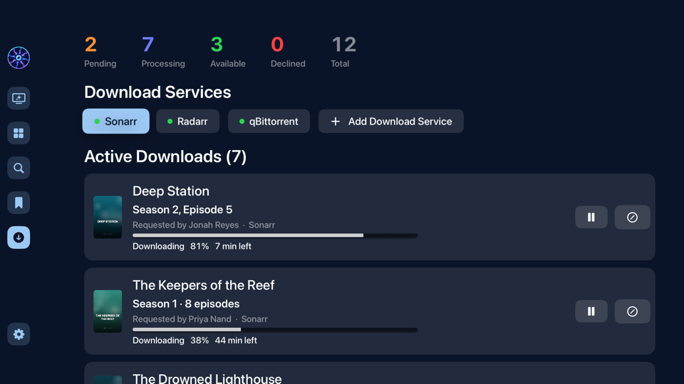

Connect your **Sonarr** and **Radarr** servers right from the Activity tab. Under the Seerr request counts, **Download Services** lists each connected server with a live status dot (green when it's reachable, red with the reason when it isn't), and **Add Sonarr or Radarr** walks you through the address and API key, testing the connection before saving. Add as many as you run, like a separate 4K Radarr.

Add your torrent client the same way: **qBittorrent**, **Deluge** or **Transmission**. Alongside Sonarr and Radarr it adds pause, resume and cancel (described below): Mindseerr matches its torrents to their downloads, so add the same client they use.

| Client | Address | Sign-in |
|---|---|---|
| qBittorrent | Web UI address, like `http://192.168.1.10:8080` | Web UI username and password |
| Deluge | Web UI address, like `http://192.168.1.10:8112` | Web UI password (default `deluge`); its Web UI has to be connected to a daemon under Connection Manager |
| Transmission | Like `http://192.168.1.10:9091` | Username and password only if you turned RPC authentication on |

**A torrent client works on its own, too.** If you don't run Sonarr or Radarr, add just qBittorrent, Deluge or Transmission and Active Downloads reads progress straight from it.

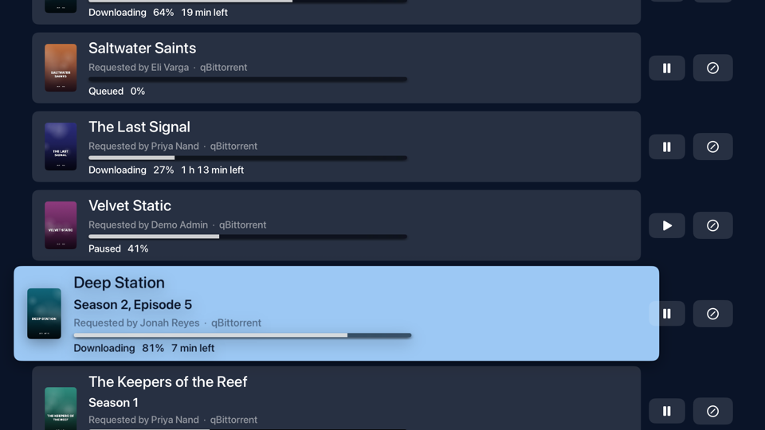

Mindseerr lists every unfinished torrent and works out which Seerr title it is from its release name, so *The.Drowned.Lighthouse.2026.1080p.WEB-DL* becomes the movie *The Drowned Lighthouse*, and *Deep.Station.S02E05* becomes Season 2, Episode 5 of *Deep Station*. Matched titles get their poster and the name of whoever requested them, and show up as progress on Discover and detail pages just like Sonarr and Radarr downloads. A torrent whose name doesn't match a title is still listed, by its release name. Finished and seeding torrents are left out.

**Active Downloads** then shows the downloads in their queues that belong to a Seerr request, matched to the request they came from: who asked for it, which server is fetching it, a progress bar, status and time left. Series show which season and episode is downloading. The list refreshes every 10 seconds. Downloads with no Seerr request behind them, such as something you added straight to Sonarr, Radarr or qBittorrent, are left out.

### Activity tab: download status on requests

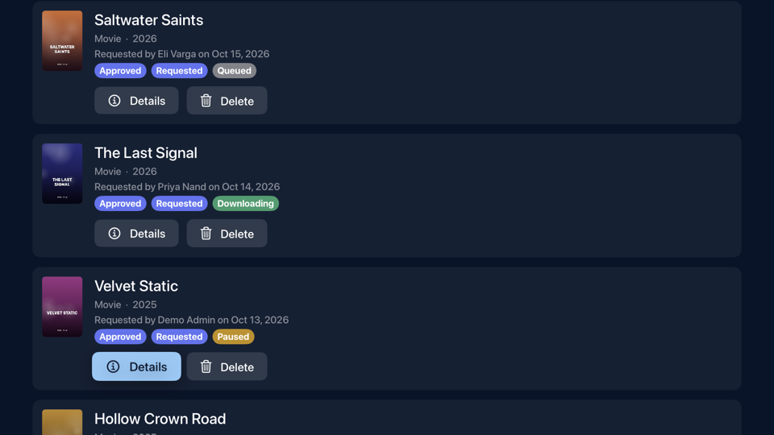

The request list knows what's downloading too. Any request whose title is in a Sonarr or Radarr queue gets a tag with its actual state, colored to match: **Downloading** (soft green), **Paused** (amber), **Queued** (gray), **Importing** (blue), **Needs attention** (orange) or **Failed** (red). You can tell at a glance an approved request that's on its way from one that's stuck.

### Activity tab: pause, resume and cancel downloads

On each row of **Active Downloads** are two round buttons. **Pause** (and **Play** to resume it) controls the torrent in qBittorrent, Deluge or Transmission, and shows once one of them is connected and holding that download. **Cancel**, the circle with a line through it, takes the download out of the Sonarr or Radarr queue and deletes the partial download from your download client, after asking you to confirm. The request stays in Seerr, so you can retry it later.

### Detail page

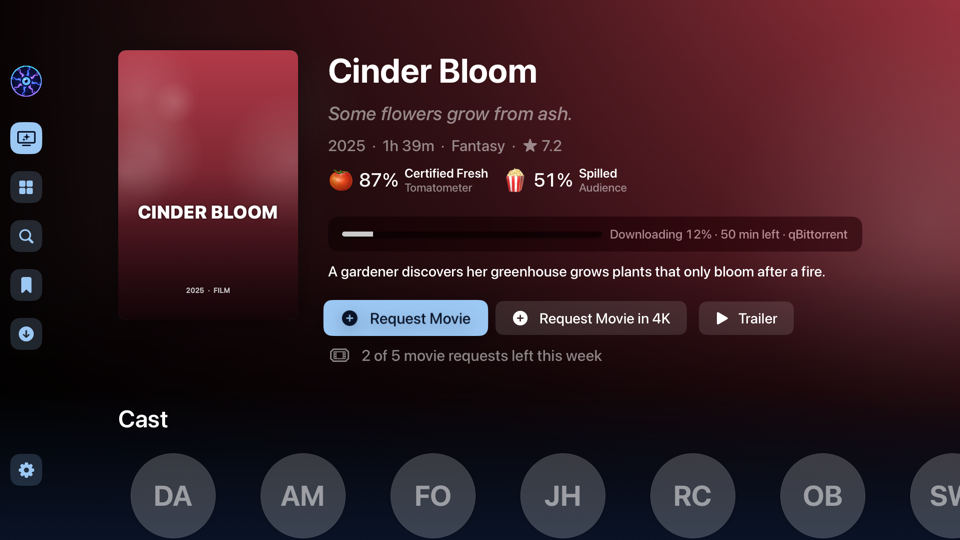

Open a title that's downloading and its progress sits right under the title on a frosted panel that stays readable over any backdrop: status, percent, time left and which server has it. For a series with several episodes downloading, each gets its own line labeled with its season and episode.

### Detail page: trailer and 4K requests

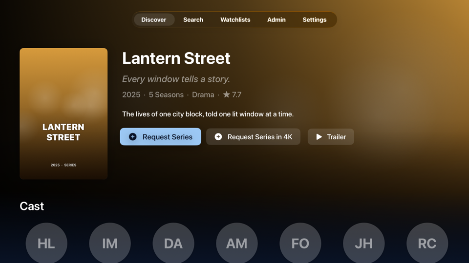

Every title opens to a page with its poster, tagline, year, runtime or season count, genres, rating and overview. Right under it are the actions. **Request** (or **Request Series**) sends it to your standard Radarr or Sonarr, and when your Seerr server has a 4K server and your account may use it, **Request in 4K** appears beside it. The two copies are tracked separately, so you can have a title available in HD and still request it in 4K, and each shows its own status: **Requested**, **Available**, **4K Requested** or **4K Available**. For a series you pick which seasons to request. **Trailer** opens the official trailer in the YouTube app, so install YouTube from the App Store on your Apple TV if you haven't.

### Detail page: Rotten Tomatoes scores

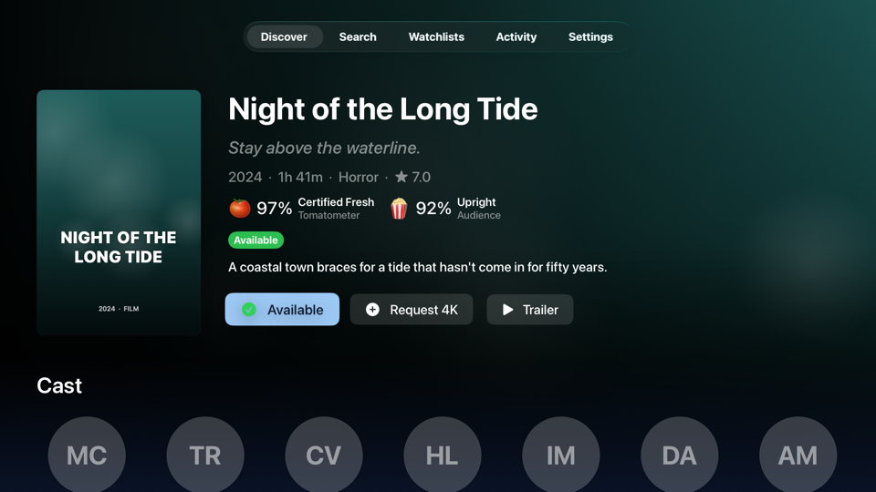

Under the title's year, runtime and genres sit its **Rotten Tomatoes** scores: the critics' **Tomatometer** with its label (Certified Fresh, Fresh or Rotten) and, for movies, the **Audience** score (Upright or Spilled). Series show the critics' score only. The scores come from Seerr, so they appear when your Seerr server can look them up and are simply left out when it can't.

### Detail page: cast, crew and suggestions

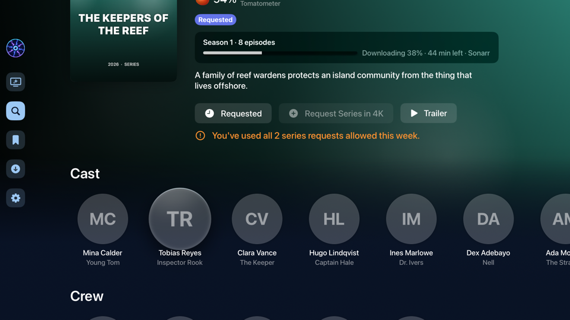

Scroll down for the **Cast**, shown as round avatars with each actor's name and the character they play, followed by the key **Crew**: director, writers, producers and composer, each with their role.

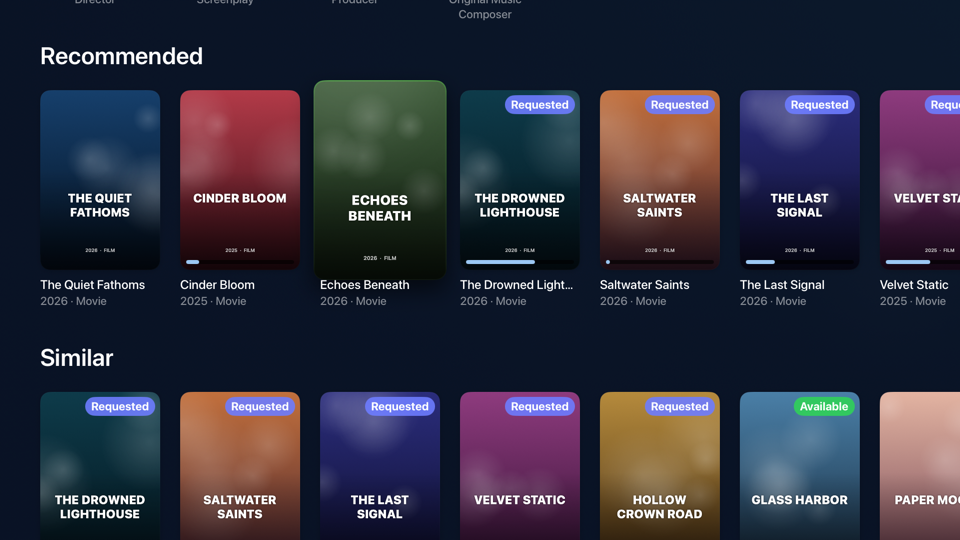

Cast and crew are selectable. Choosing one opens their page, with their photo, a short bio and their other movies and series, **best rated first**.

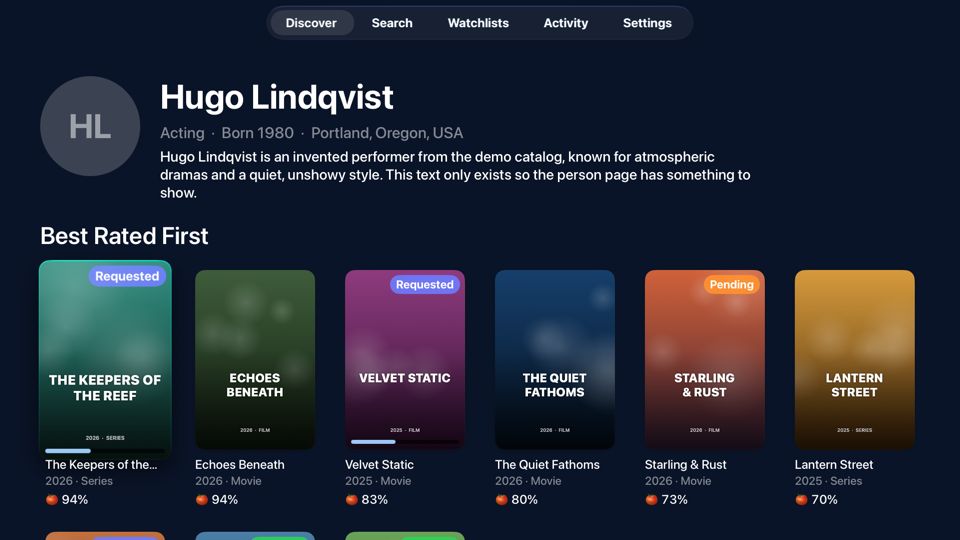

The order follows each title's Rotten Tomatoes Tomatometer, printed under its poster. Titles without a Rotten Tomatoes score fall back to TMDB's rating, shown as a star. Each title is a normal poster card with its availability badge, so you can open it and request it from there.

Below that, **Recommended** and **Similar** rows suggest more to watch. They're ordinary poster cards, so each one carries its availability badge and any download progress bar, and selecting one opens its own detail page. It's an easy way to find the next thing to request without going back to search.

### Download finished notification

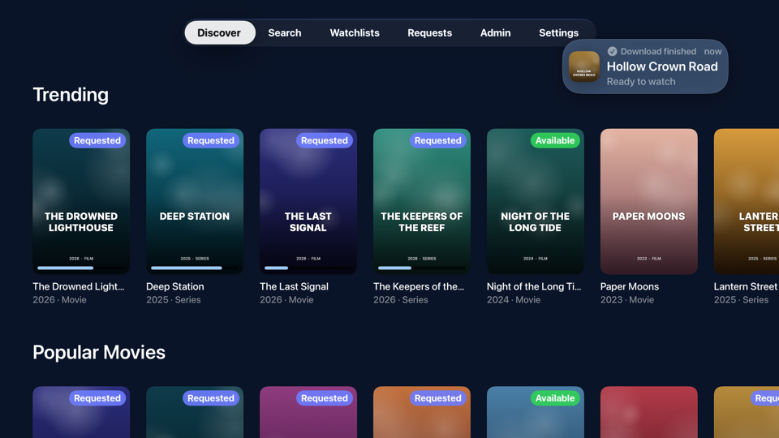

When a download for one of your requests finishes, a **Download finished** banner slides into the top right corner, shaped like an iOS or macOS notification: a rounded, see-through card tinted with your theme's highlight color, with the title's poster, its name and, for a series, the season and episode. It appears over whichever screen you're on, stays for a few seconds, and never takes the remote's focus. If several finish together they show one after another. Downloads you cancel yourself don't count, and neither do failed ones. A download counts as finished when it leaves the queue nearly done or importing.

tvOS doesn't allow banners from an app that isn't open, so while Mindseerr is closed nothing can pop up. Instead, Mindseerr remembers what was downloading when you last used it, and when you reopen it, shows a banner for each download that finished in the meantime (a few of them, then one banner for the rest). While it's open, banners appear on any tab as downloads finish. You can turn it off under **Settings → Notifications → Download Finished**.

### Discover: suggested for you

A **Suggested for You** row sits at the top of Discover. Mindseerr builds it from Seerr's own data, in four steps:

1. **Seeds:** your own recent requests, counted three times as heavily, plus the titles that are available on your server.
2. **Candidates:** the recommendations Seerr gives for each seed. A title that several seeds point at scores higher.
3. **Filtering:** anything already available, being downloaded or requested is dropped.
4. **Rotten Tomatoes:** the best candidates are checked against their Rotten Tomatoes scores (critics, averaged with the audience score when there is one; TMDB's rating stands in when there is none). Well-rated titles are promoted and poorly rated ones demoted, and clearly bad ones are left out as long as enough good ones remain.

The row is worked out when you open Discover and kept for a few hours, and it stays hidden until there's something to show. On a non-admin account, "all available titles" may be limited to your own, because Seerr only shows regular users their own requests.

### Discover: progress on posters

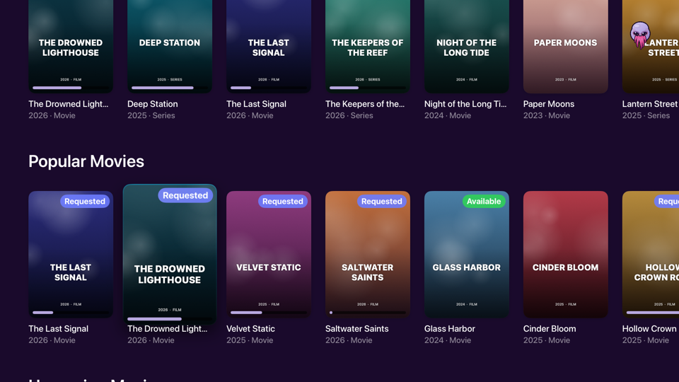

While browsing, posters of titles that are downloading get a thin progress bar along their bottom edge, drawn in the current theme's highlight color, on Discover, in expanded sections and in Search. No need to open anything to see what's on its way.

### Watchlists

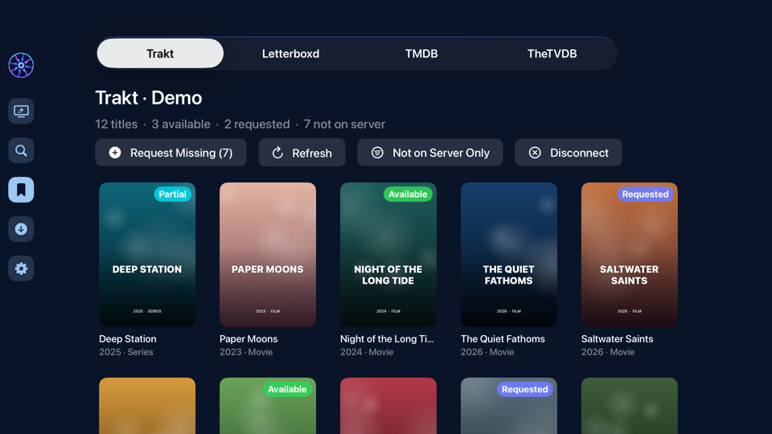

Bring your watchlists along. Pick **Trakt**, **Letterboxd**, **TMDB** or **TheTVDB** along the top and Mindseerr imports it and matches every title to your Seerr server. Each poster gets a badge: **Available** (green), **Requested** (indigo) or **Partial** (teal, when some seasons are still missing), and titles that aren't on your server carry no badge. A summary line counts what's available, requested and missing.

**Request Missing** opens a **Choose What to Request** screen first, so you decide what actually gets requested instead of sending everything (below). **Not on Server Only** filters the grid down to just the missing titles, and **Refresh** imports the list again. Select any poster to open its detail page and request it from there. Titles that can't be matched to a movie or series stay visible and are marked **No Match**.

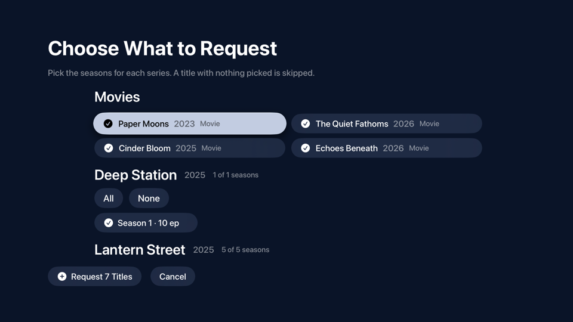

Every missing movie and series starts ticked. Untick any movie you don't want, and for each series pick just the seasons you're after, with **All** and **None** shortcuts. Only seasons that can still be requested are offered (ones already available or requested are left out), each with its episode count. A series with no seasons picked is skipped, and the button counts what you're about to send, such as **Request 7 Titles**.

### Connecting a watchlist

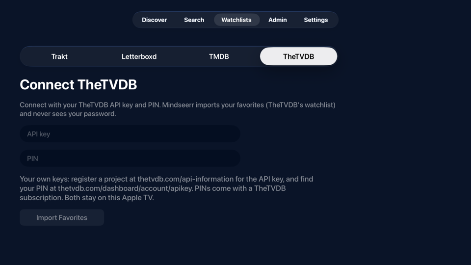

Each service connects the way it allows. **Trakt** and **TMDB** sign in with a code or QR link you approve on your phone, so your password never touches the TV. **TheTVDB** takes your own API key and PIN and imports your favorites, which is its version of a watchlist. **Letterboxd** reads your public watchlist page from just your username. Every screen explains where to find what it asks for, and keys you enter stay in the Keychain on your Apple TV.

### Top Shelf

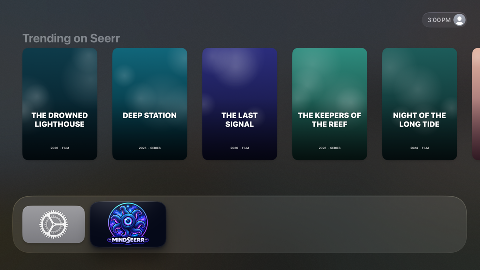

Put Mindseerr in the top row of your Home Screen and the **Top Shelf**, the area above your apps, fills with a section of Discover, Trending by default. Highlight Mindseerr to see the posters, then select one to open that title's page in the app. The titles are the ones Mindseerr last loaded for that section on Discover, so open the app now and then to keep the row fresh. Until it has loaded Discover once, tvOS shows the Mindseerr banner instead.

### Choosing what the Top Shelf shows

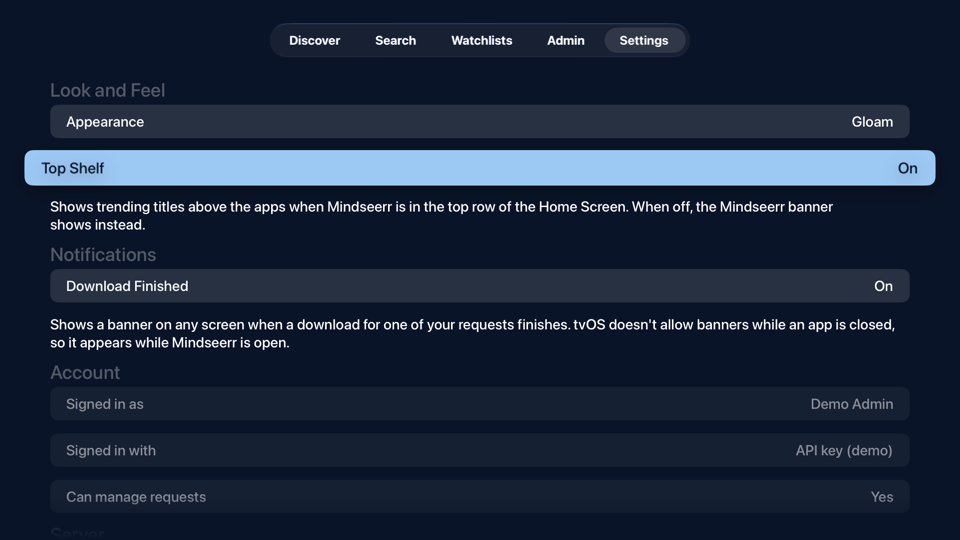

Top Shelf is one menu. Open **Settings** and select **Top Shelf** under **Look and Feel** to pick what it shows: **Suggested for You**, **Trending** (the default), **Popular Movies**, **Upcoming Movies**, **Popular Series** or **Upcoming Series**. Choose **Off** at the top of that list to turn it off, and the Home Screen shows the Mindseerr banner instead. The change applies right away. The same section holds **Appearance**, where you pick the app's theme.

## Features

- **Plex sign-in** with the TV-friendly code flow: the app shows a 4-character code, you enter it at plex.tv/link on any device.
- **Jellyfin and Emby sign-in** with your media server username and password. The app asks Seerr which server it uses and shows the right screen.
- **Seerr account sign-in** (email and password, for accounts created in Seerr) and **API key sign-in** (signs in as the server's main admin account). Both are offered under "Or sign in with" on the sign-in screen.
- **Download finished banner** on any screen while the app is open, with a switch in Settings.
- **Download controls**: connect qBittorrent, Deluge or Transmission to pause, resume or cancel a download right from Active Downloads on the Activity tab. They also work without Sonarr or Radarr, reading download progress straight from the client.
- **Activity tab** for everyone. Admins and users with the Manage Requests permission get the full panel: request counts, filters (Pending, Processing, Failed, Available, All), Approve, Decline, Approve All, Retry for failed requests, and Delete.
- **Eight themes** to choose from in Settings → Look and Feel → Appearance: Sludge, Bile, Gloam (the default), Despair, Rage, Abyss, Smoke and Mist. Abyss is true black (#000000) so OLED pixels stay off behind the UI, and Mist is a light off-white theme.
- **About page**, opened from the logo at the bottom of Settings, with the version, a link to the GitHub project and credits for Trakt, TMDB, TheTVDB and Plex.
- **Discover**: Suggested for You, Trending, Popular Movies, Upcoming Movies, Popular Series, Upcoming Series. Rows page in more titles as you scroll.
- **Search** across movies and series with the tvOS search keyboard. Results show availability badges and download progress like Discover.
- **Detail pages** with backdrop, overview, runtime/seasons, genres, rating and live availability.
- **Requests**: request a movie, or pick specific seasons of a series. Seasons already available or requested are locked.
- **Watchlists**: import your Trakt, Letterboxd, TMDB and TheTVDB watchlists, see which titles are already on your server, and request the rest. Pick which titles, and which seasons of each series, to send.
- **Tabs that reset**: Discover, Search, Watchlists, Activity and Settings each return to their top level when you leave them and come back, and Search clears its box.
- **Five tabs**: Discover, Search, Watchlists, Activity and Settings. The Activity tab changes with who's signed in: admins see every request with approvals and download controls, and everyone else sees their own unfinished requests and where each one stands.
- Session survives relaunches (cookie and sign-in credentials in the Keychain); if the Seerr session expires, the app silently signs in again.

## Requirements

- Mac with Xcode 16 or later
- tvOS 17+ (Apple TV HD or 4K, or the Apple TV simulator)
- A Seerr server using Plex, Jellyfin or Emby
- [XcodeGen](https://github.com/yonaskolb/XcodeGen) to generate the project: `brew install xcodegen`

## Build & run

```sh
cd Mindseerr
xcodegen generate
open Mindseerr.xcodeproj
```

1. Select the **Mindseerr** target → *Signing & Capabilities* → pick your Team. Change the bundle ID from `com.example.mindseerr` if you like (or edit `project.yml` and regenerate).
2. Choose an Apple TV simulator or your paired Apple TV and press **Run**.
3. Enter your server address (e.g. `http://192.168.1.10:5055` or `https://seerr.example.com`), then sign in with the Plex code.

To run on a real Apple TV: on the Apple TV open *Settings → Remotes and Devices → Remote App and Devices*, then in Xcode open *Window → Devices and Simulators* and pair it.

## Watchlists (Trakt, Letterboxd, TMDB, TheTVDB)

The **Watchlists** tab imports a watchlist, matches every title to your Seerr server and shows whether it's available, requested or missing. Open a title to request it, or use **Request Missing** to pick which titles, and which seasons of each series, to send.

| Service | How it connects | What you need |
|---|---|---|
| Trakt | Real sign-in: a code on the TV, approved on Trakt's activation page | Your Trakt app's Client ID in `project.yml` (below) |
| Letterboxd | Reads your public watchlist page by username | Watchlist set to public |
| TMDB | Real sign-in: scan a QR code and approve on themoviedb.org | Your own TMDB API Read Access Token, entered in the app |
| TheTVDB | Your TheTVDB PIN; imports your favorites (TheTVDB's watchlist) | Your own TheTVDB API key and subscriber PIN, entered in the app |

Letterboxd's API is invite-only, so it doesn't allow an app sign-in. Mindseerr reads the public watchlist page and never asks for your password. If Letterboxd changes its pages or blocks the request, import the watchlist into Trakt on trakt.tv and use the Trakt tab instead.

### Setting up Trakt

1. At [developer.trakt.tv](https://developer.trakt.tv/apps/new), create a new app named Mindseerr. For the **Redirect URI**, use `urn:ietf:wg:oauth:2.0:oob`. Trakt warns about it because it's meant for web sign-ins, but Mindseerr signs in with a code and never redirects. If Trakt won't save it, use any `https://` address you own instead. (Trakt may ask you to verify your account with GitHub first.)
2. In `project.yml`, paste the **Client ID** into `TRAKT_CLIENT_ID`. Leave `TRAKT_CLIENT_SECRET` empty: Trakt stopped issuing secrets to new apps in October 2026, and the TV code sign-in doesn't need one. If you registered an `https://` redirect, put the same address in `TRAKT_REDIRECT_URI`; it's sent when the app renews your sign-in and must match.
3. Run `xcodegen generate` and build again.

The Client ID is built into the app. That's expected for TV apps and isn't a secret on its own.

### Setting up TMDB and TheTVDB

Each person enters their own key on the service's tab in the app; it's kept in the Keychain on that Apple TV.

- **TMDB:** at [themoviedb.org/settings/api](https://www.themoviedb.org/settings/api), request a free API key and paste the long **API Read Access Token**, then sign in with the QR code.
- **TheTVDB:** register a project at [thetvdb.com/api-information](https://thetvdb.com/api-information) for an API key, and take your PIN from [thetvdb.com/dashboard/account/apikey](https://thetvdb.com/dashboard/account/apikey) (PINs come with a subscription).

To ship a build with a key already inside, set `TMDB_READ_ACCESS_TOKEN` or `TVDB_API_KEY` in `project.yml` and run `xcodegen generate`. A key entered in the app takes priority.

## Make an IPA

On your Mac, in Terminal:

```sh
cd Mindseerr
./make-ipa.sh
```

It generates the project if needed, archives a Release build and writes `Mindseerr.ipa` next to the script.

- **Signed (default)** uses the Team you picked in Xcode. It installs on Apple TVs registered to your team. Pair yours first (Xcode → Window → Devices and Simulators), then install the IPA from that same window: select the Apple TV, click **+** under *Installed Apps* and pick the file.
- **`TEAM=ABCDE12345 ./make-ipa.sh`** passes your team ID directly, if Xcode lost the Team setting after `xcodegen generate`.
- **`./make-ipa.sh --unsigned`** makes `Mindseerr-unsigned.ipa` for signing later with another tool.

With a free Apple ID the signed app expires after 7 days; run the script again to renew it.

## Project layout

```
Mindseerr/
├── make-ipa.sh                Builds Mindseerr.ipa (see above)
├── project.yml                  XcodeGen spec (tvOS 17, ATS allows http for LAN servers)
└── Mindseerr/
    ├── App/                     App entry, RootView, tabs, AppState (session & phase)
    ├── Models/                  Codable types for media, requests, users
    ├── Networking/              SeerrClient (actor), PlexAuth (PIN flow), Keychain
    │   └── Watchlists/          Trakt, TMDB and TheTVDB clients, Letterboxd importer, WatchlistStore
    └── Views/
        ├── Onboarding/          Server address, sign-in (Plex, Jellyfin/Emby, Seerr account, API key)
        ├── Admin/               Activity tab: the admin panel, and each user's own requests
        ├── Discover/            Paginated poster rows
        ├── Search/              Debounced search grid
        ├── Detail/              Detail page + season picker
        ├── Watchlists/          Watchlists tab, connect screens, Trakt sign-in
        ├── Settings/            Account, server, sign out
        └── Components/          Posters and status badges
```

## How it talks to Seerr

All calls go to `<server>/api/v1`:

| Purpose | Endpoint |
|---|---|
| Validate server | `GET /status` |
| Server type | `GET /settings/public` (`mediaServerType`: 1 Plex, 2 Jellyfin, 3 Emby) |
| Sign in | `POST /auth/plex` `{ authToken }`, `POST /auth/jellyfin` `{ username, password }` or `POST /auth/local` `{ email, password }` → `connect.sid` cookie; or an `X-Api-Key` header on every request |
| Current user | `GET /auth/me` |
| Discover rows | `GET /discover/trending`, `/discover/movies`, `/discover/movies/upcoming`, `/discover/tv`, `/discover/tv/upcoming` |
| Search | `GET /search?query=…&page=…` |
| Details | `GET /movie/{tmdbId}`, `GET /tv/{tmdbId}` |
| Request | `POST /request` `{ mediaType, mediaId, seasons?, is4k }` |
| Match an IMDb ID | `GET /search?query=imdb:tt…` |
| Admin: list / counts | `GET /request?filter=pending\|processing\|failed\|available\|all`, `GET /request/count` |
| Admin: actions | `POST /request/{id}/approve`, `POST /request/{id}/decline`, `POST /request/{id}/retry`, `DELETE /request/{id}` |

## Notes & troubleshooting

- **API key sign-in** acts as Seerr's main admin account (user 1), so requests you make are made as that account. Use it only on your own Apple TV. The key is in Seerr → Settings → General.
- **Seerr account sign-in** needs *Settings → Users → Enable Local Sign-In* turned on in Seerr. Seerr accounts sign in by email, not username.

- **"Access denied" after signing in**: the account has to be allowed on the Seerr server. In Seerr, import the user (*Users → Import Plex/Jellyfin Users*) or enable new Plex/Jellyfin sign-ins under *Settings → Users*.
- **Jellyfin password storage**: to sign back in silently when the Seerr session expires, the Jellyfin username and password are kept in the Apple TV Keychain. Signing out deletes them.
- **CSRF protection**: if *Settings → Network → CSRF Protection* is turned on in Seerr, POST requests from the app will be rejected. Leave it off (the default) or extend `SeerrClient` to send the XSRF token.
- **Self-signed HTTPS** certificates aren't trusted by tvOS. Use plain `http://` on your LAN or a real certificate (e.g. via a reverse proxy).
- **App icon**: `Assets.xcassets` holds a layered tvOS icon (Front / Middle / Back layers for the parallax tilt) and Top Shelf images. To use your own artwork, open the asset catalog in Xcode and drag PNGs onto each slot: icon layers at 400×240 (@1x) and 800×480 (@2x), the App Store icon at 1280×768, Top Shelf at 1920×720 / 3840×1440, and Top Shelf Wide at 2320×720 / 4640×1440. The Back layer must have no transparency.

## Ideas for next steps

Done:

- [x] 4K requests when the server has a 4K Radarr/Sonarr
- [x] Request-option overrides (server, quality profile, root folder) for users with *Advanced Requests*
- [x] Cast & crew and "Similar"/"Recommended" rows on detail pages
- [x] Top Shelf extension showing trending titles, with an on/off switch in Settings
- [x] Watchlists from Trakt, Letterboxd, TMDB and TheTVDB, with a picker for titles and seasons
- [x] qBittorrent, Deluge and Transmission: progress without Sonarr or Radarr, and pause, resume and cancel for downloads
- [x] A banner when a download finishes, on any screen, including ones that finished while the app was closed (shown when it's reopened)
- [x] Themes, including a light one
- [x] Tabs that return to their top level when you leave them

Still to do:

- Support usenet clients (SABnzbd, NZBGet) for progress and the download controls
- A request list for non-admin users, now that the Requests tab is gone (for example on the Settings or Discover screens)
- An optional API key sign-in for qBittorrent 5.2 and newer, next to the username and password
- Browse Discover by genre, studio or network, and filter or sort search results
- Trust a self-signed HTTPS certificate for Seerr and the download services, after the user approves it
- Send Seerr's XSRF token so the app works with CSRF protection turned on
- Localization
- A signed build through TestFlight or the App Store, so installing doesn't need sideloading
